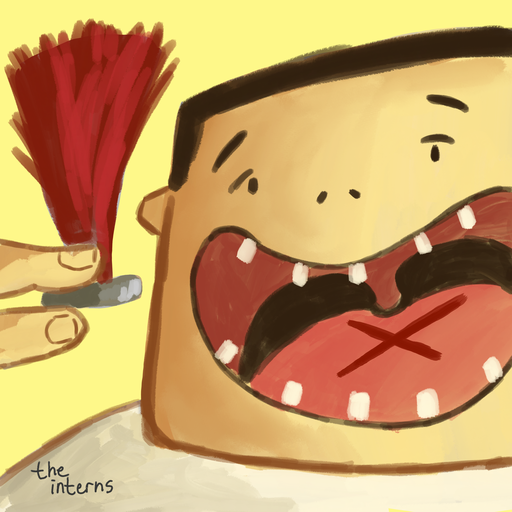

  

<h1 align="center">Takyan X website</h1>

A website for Takyan X downloads: a QR code and links to get the game on Android and PC.

## What is Takyan X?

Takyan X is a 3D game based on takyan, the traditional Filipino kick-game, similar to hacky sack or shuttlecock kicking.

Play solo to juggle the takyan for a personal best or face a bot, or play multiplayer in 1v1 or Rambol with up to 5 players.

Made by The Interns of Cebu Institute of Technology – University, a finalist at the Level Up 3.0 Esports Game Dev Challenge (Student Category).
